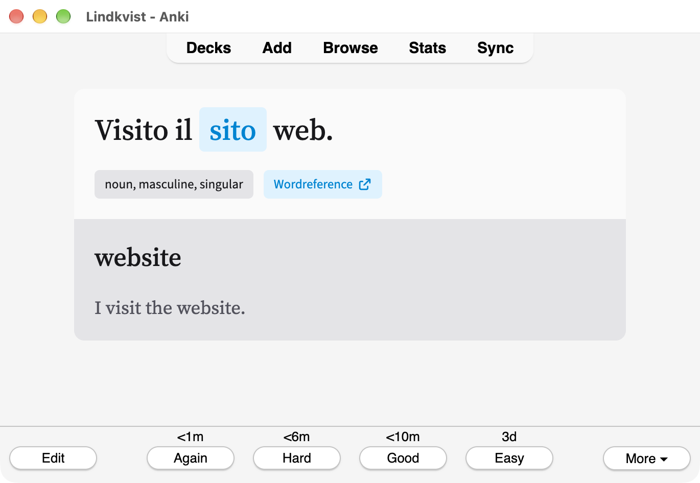

# Anki Lindkvist



A beautiful Anki card template with an example Italian vocabulary deck.

## 📋 Overview

This repository contains:

- **Card template** — custom HTML/CSS for cloze vocabulary cards
- **Example deck** — Italian→English vocabulary (CEFR A1–B1), as CSV and a ready-to-import `.apkg`
- **Generation tools** — an AI prompt and an agent skill for producing more rows in the same format

The example Italian deck includes:

- Cloze deletion sentences for context-based learning
- Part-of-speech tagging and grammatical information
- English translations for both words and example sentences
- Audio / TTS support for pronunciation
- Modern, natural Italian examples (CEFR A1–B2 level)

## 🗂️ Project structure

```
card/
├── front.html          # Front side template
├── back.html           # Back side template
└── style.css           # Card styling

example/
├── LindkvistItaliano.apkg      # Exported Anki deck
├── LindkvistItalianoA1.csv     # A1 vocabulary
├── LindkvistItalianoA2.csv     # A2 vocabulary
├── LindkvistItalianoB1.csv     # B1 vocabulary
└── agents/
    ├── PROMPT.md               # Standalone prompt for generating CSV rows
    └── skills/
        └── lindkvist-italian-csv/   # Agent skill (same format + evals)
```

## 🚀 Usage

### Card template

1. Copy `card/front.html`, `card/back.html`, and `card/style.css` into your Anki note type.
2. Ensure field names match the CSV columns below (`ExampleSentence`, `WordPOS`, etc.).

### Example deck

- Import `example/LindkvistItaliano.apkg`, or import one of the CEFR CSVs (`A1` / `A2` / `B1`).
- Install [AwesomeTTS](https://ankiweb.net/shared/info/1436550454) (or similar) if you want text-to-speech on `TTSSentence`.

### Creating new content

**Option A — agent skill (recommended)**

Use the skill at `example/agents/skills/lindkvist-italian-csv/`. It appends Lindkvist-format rows (header + cloze rules, tags, conjugated verb forms) to a CSV.

**Option B — prompt**

1. Open `example/agents/PROMPT.md`.
2. Replace `<<REPLACE_WITH_WORDS>>` with Italian lemmas.
3. Paste into an AI tool; append the generated rows to a CSV and import into Anki.

## 📝 Card format

- **Front:** Italian sentence with cloze deletion
- **Back:** Full sentence, English translation, and grammatical information
- **Audio:** Driven by `TTSSentence` (plain Italian without cloze markup)
- **Tags:** Italian-style labels for filtering (e.g. `sostantivo femminile`, `verbo fare`)

## 📊 Data format

Semicolon-separated CSV with this header:

```
Word;ExampleSentence;WordPOS;TranslationWord;TranslationSentence;TTSSentence;Audio;Tags
```

| Field | Content |
|-------|---------|
| `Word` | Form being taught (conjugated for finite verbs; otherwise the lemma) |
| `ExampleSentence` | Short Italian sentence with the target in `{{c1::…}}` |
| `WordPOS` | POS plus minimal grammar (`noun, feminine, singular`, `verb, 3rd person singular, presente`, …) |
| `TranslationWord` | Concise English gloss |
| `TranslationSentence` | Natural English of the whole sentence |
| `TTSSentence` | Same as `ExampleSentence` with cloze markup removed |
| `Audio` | Leave empty (filled by Anki/TTS add-ons) |
| `Tags` | Space-separated Italian tags matching the Lindkvist deck |

Escape literal semicolons inside fields as `\;`. Multiple senses of a word → one row per sense.

## 📄 License

See [LICENSE.md](LICENSE.md) for license information.

---

_Happy learning! 🇮🇹_
